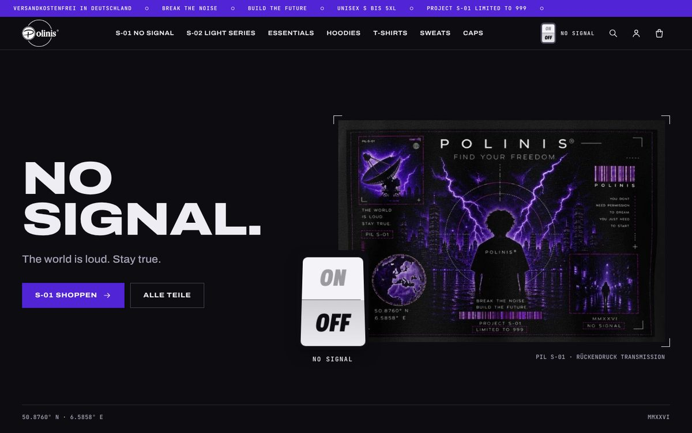
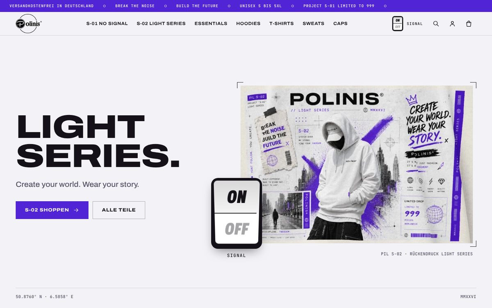

# Polinis® ON/OFF – WordPress-Shop

Neubau von [polinis-onlineshop.de](https://polinis-onlineshop.de/) (bisher Shopify) als WordPress + WooCommerce-Shop mit eigenem Theme.

**Konzept:** Ein Schalter, zwei Welten. OFF = S-01 „No Signal“ (dunkel), ON = S-02 „Light Series“ (hell). Details in [docs/KONZEPT.md](docs/KONZEPT.md).




## Inhalt

| Pfad | Was |
|---|---|
| `wp-content/themes/polinis/` | Das Theme „Polinis ON/OFF“ (klassisches PHP-Theme, WooCommerce-fähig) |
| `tools/import-shopify.php` | Importiert alle 31 Produkte mit Varianten, Preisen, Bildern und Pflicht-PDFs aus dem Shopify-Shop |
| `tools/setup-shop.sh` | Richtet ein frisches WordPress komplett ein (WooCommerce, Theme, Versand, Seiten, Import) |
| `data/shopify-products.json` | Export der Produkte aus dem bisherigen Shop |
| `data/product-map.json` | Neue Produktnamen, Serie und Kategorie je Produkt – hier Namen ändern und Import neu starten |
| `docs/` | Konzept, Design-Brief, Screenshots |
| `docs/serien/` | Druckfertige Motive der geplanten Serien S-03 bis S-05 (SVG) |
| `tools/series.py`, `tools/mockup.py` | Erzeugen die Serien-Motive und legen sie als Mockup auf die Rohlinge |
| `tools/export-preview.py` | Exportiert den Shop als statische Vorschau-Seite |
| `DESIGN.md` | Farben, Schriften, Bausteine des Themes |

## Installation

Voraussetzung: Webhosting mit WordPress (PHP 8.1+) und SSH-Zugang mit [WP-CLI](https://wp-cli.org/).

```bash
# im WordPress-Verzeichnis
git clone <dieses-repo> ~/polinis
bash ~/polinis/tools/setup-shop.sh
```

Das Skript installiert WooCommerce, aktiviert das Theme, legt kostenlosen Versand für Deutschland an, erstellt die Seiten Impressum, Datenschutz, AGB, Widerrufsrecht, Versand und Kontakt (leer) und importiert alle Produkte. Der Import kann gefahrlos wiederholt werden.

**Ohne SSH:** Ordner `wp-content/themes/polinis` als ZIP unter *Design → Themes → Hochladen* installieren. Die Produkte dann per WP-CLI oder vom Webdesigner importieren lassen.

## Danach von Hand erledigen

1. **Rechtstexte** aus dem alten Shop in die sechs Seiten kopieren (Impressum, Datenschutz, AGB, Widerrufsrecht, Versand, Kontakt).
2. **Zahlungsarten** verbinden: *WooCommerce → Einstellungen → Zahlungen* (PayPal Payments, Klarna, Stripe für Apple/Google Pay und Karte).
3. **Germanized** oder **German Market** installieren (Grundpreise, Lieferzeiten, Checkbox-Pflichten, Rechnungen).
4. **Steuern** einrichten (19 % MwSt.), Preise sind bereits brutto hinterlegt.
5. **Print-on-Demand anbinden:** Bilder und Artikelnummern sehen nach Printful aus. Falls ja: das Printful-Plugin für WooCommerce verbinden, damit Bestellungen automatisch rausgehen.
6. **Domain umstellen** und den Shopify-Shop erst kündigen, wenn alles läuft.

## Anpassen

- **Texte der Startseite, Laufband, Startzustand des Schalters, nächster Drop mit Countdown:** *Design → Customizer → Polinis* (Datum im Format `2026-12-05 18:00`, leer = „Datum folgt“, Name leer = Leiste aus)
- **Menüs:** *Design → Menüs* (Hauptmenü, Footer: Shop, Footer: Rechtliches). Ohne eigenes Menü baut das Theme die Navigation aus Serien und Kategorien.
- **Geplante Serien:** stehen in `inc/series.php` (Name, Satz, Text, Bild). Wenn S-03 startet: Status auf `live` setzen, Produkt-Schlagwort `s-03` anlegen, Produkte zuordnen.
- **Neue Serie (z. B. S-06):** Produkt-Schlagwort `s-03` anlegen und Produkte zuordnen – die Serienseite entsteht automatisch. Für Startseite, Menü und eigene Welt (hell/dunkel) die Liste in `functions.php` und `front-page.php` ergänzen.
- **Drop-Anmeldungen:** *Werkzeuge → Drop-Signal* (mit CSV-Export).

## Technik

- Schriften (Archivo, JetBrains Mono, OFL-Lizenz) liegen im Theme – keine Verbindung zu Google Fonts.
- Kein Page-Builder, keine Abhängigkeiten außer WooCommerce. Ein CSS, ein kleines JS.
- Der Schalter merkt sich die Wahl im Browser. Serienseiten und Serienprodukte erzwingen ihre Welt (S-01 dunkel, S-02 hell).
- Umschalten mit kreisförmigem Übergang vom Schalter aus (View Transitions, in Browsern ohne Unterstützung sofort). Respektiert „Bewegung reduzieren“.
- Getestet lokal mit WordPress 7.1 und WooCommerce 11.3.
